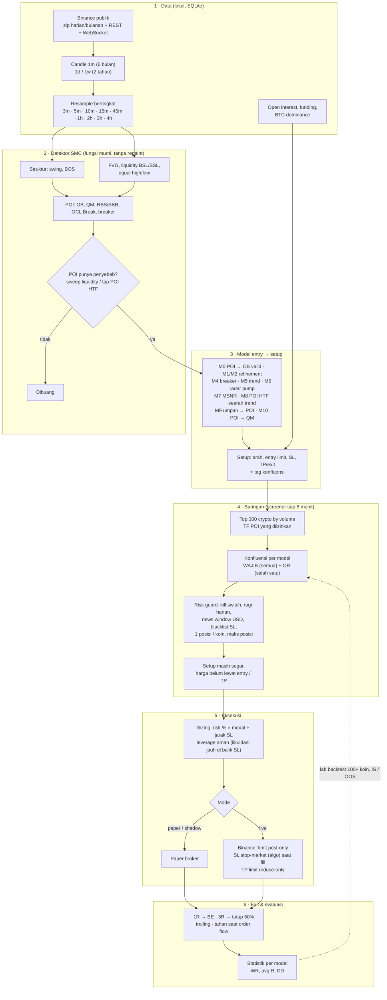
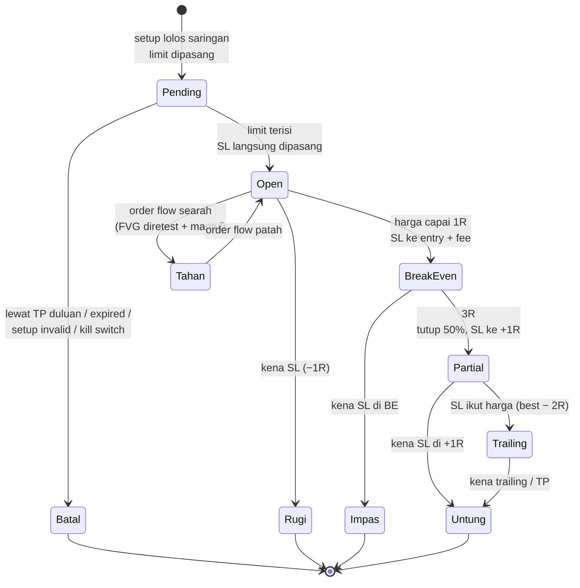

# SMC Trading Assistant

**Kontributor ide:** [Rizalphlv](https://github.com/Rizalphlv) · [adam080880](https://github.com/adam080880)

Aplikasi desktop (Electron) untuk membantu trading crypto di **Binance USDT-M Futures**: deteksi konsep
SMC/ICT, screener, backtest, bot (paper/live), radar pump, kalender news USD, dan Claude sebagai analis.

> *English:* a desktop assistant for Binance USDT-M futures — SMC/ICT pattern detection, screener,
> backtester, paper/live bot, pump radar with Discord alerts, and USD economic news. UI is in Indonesian.

> [!WARNING]
> **Bukan saran keuangan.** Trading futures pakai leverage bisa menghabiskan modal. Mode **live** mengirim
> order beneran ke akun Binance kamu. Hasil backtest tidak menjamin hasil ke depan. Hampir semua model di
> sini **belum punya edge yang konsisten setelah fee** (lihat [Hasil riset](#hasil-riset-jujur)).
> Pakai dengan risiko sendiri, mulai dari mode **paper**.

## Fitur

| Halaman | Isi |
|---|---|
| **Chart** | Candle 1m–1w (lightweight-charts), overlay SMC (structure, BOS, OB, FVG, RBS/SBR, OCL, QM, liquidity), setup aktif, posisi bot live dengan R berjalan, tombol close/cancel, buka trade lama dari Bot/Backtest |
| **Screener** | Scan semua koin yang punya histori: setup aktif, harga dekat POI 1h/4h, BOS baru, trend searah. Otomatis tiap 5 menit (bisa 1–15) |
| **Backtest** | Satu koin, semua model × semua rencana exit sekaligus, fill/exit di candle 1m, fee + slippage, split in-sample / out-of-sample, tab Meta untuk menyimpan profil per koin |
| **Bot** | Paper atau live. Risk per trade dalam % dari saldo atau dari modal tetap, SL wajib, leverage aman di bawah likuidasi, exit bertingkat + order flow, statistik per model (win / BE / loss, DD maks) sejak tanggal tertentu |
| **Rotasi** | Forward test rotasi momentum long/short. **Paper saja**, tidak pernah kirim order |
| **Kalender** | Event USD (jadwal + forecast + actual dari BLS/FRED), bias USD → crypto, news window |
| **Claude Analyses** | Analisis berkala koin watchlist lewat Claude Agent SDK (opsional, read-only tools) |
| **Radar pump** | Koin dengan volume 24 jam ≥ 8× median atau funding negatif + volume tinggi → notifikasi Discord/desktop |

## Cara kerja bot

Gambaran besar: data harga Binance disimpan lokal, tiap timeframe dianalisis dengan detektor SMC/ICT, model entry
mengubah POI jadi *setup* (limit + SL + rencana exit), lalu setup disaring berlapis sebelum jadi order.



Siklus hidup satu order:



## Apa itu SMC (versi app ini)

**SMC (Smart Money Concepts)** / **ICT** adalah cara membaca chart dengan asumsi harga bergerak ke tempat
banyak order menunggu (liquidity), lalu bereaksi di zona tempat pemain besar dulu masuk (POI, *point of
interest*). App ini **tidak** memakai definisi ICT umum mentah-mentah. Aturannya diambil dari materi kursus
yang dipelajari penulis, ditulis ulang di [`docs/smc-rules.md`](docs/smc-rules.md), lalu dijadikan kode yang
bisa dites. Semua detektor ada di `src/main/strategy/`.

| Konsep | Arti di app ini |
|---|---|
| **Market structure** (HH, HL, LH, LL) | Trend naik = rangkaian Higher High + Higher Low; trend turun = Lower High + Lower Low. Trend dianggap lanjut selama low (naik) / high (turun) terakhir tidak ditembus |
| **BOS** (Break of Structure) | Close menembus swing yang menjaga trend → **trend berbalik**. (Di ICT umum ini disebut CHoCH; app memakai istilah materi) |
| **CHoCH LTF** | Flip struktur kecil di TF entry (15m) setelah harga menyentuh POI besar. Dipakai sebagai konfirmasi |
| **Order Block (OB)** | Candle di swing low/high yang wick-nya lebih panjang dari candle sebelumnya **dan** warnanya searah (OB bullish = candle hijau dengan wick bawah panjang). Wick panjang = sisa liquidity. Garis entry = ujung body |
| **OB valid** | "POI kena POI": setelah OB/POI pertama kena, terbentuk OB baru di dekatnya. Itulah yang dipakai untuk limit |
| **FVG** (Fair Value Gap) | Celah tiga candle yang wick-nya tidak saling menutup. **Hanya konfluensi**, app tidak pernah entry di FVG |
| **RBS / SBR** | Resistance yang ditembus close jadi support (RBS), atau sebaliknya (SBR) |
| **OCL / OCL Break** | Dua candle searah berurutan (level = close candle pertama); OCL Break = candle lawan arah yang close melewati body itu. OCL biasa cuma digambar di chart; yang jadi POI induk hanya **OCL Break dari TF besar** (4h/1d/1w) |
| **QM** (Quasimodo) | Pola "tiga gunung": gunung kedua menembus gunung pertama, entry saat harga kembali ke body gunung pertama |
| **Liquidity** | Wick OB yang belum tersapu + swing high/low (BSL/SSL) dan equal high/low yang belum disapu |
| **Sweep** | Harga menembus liquidity lalu balik. Banyak model mensyaratkan POI terbentuk karena sweep (*origin*) |

Detektor hanya memakai candle yang sudah close (tidak repaint), dan **fungsi yang sama** dipakai chart,
screener, backtest, dan bot. Jadi hasil backtest = perilaku live.

## Model entry

Setiap model menghasilkan *setup*: arah, harga entry (limit), SL, dan rencana exit. Model bisa dinyalakan
satu per satu di **Settings → Bot entry**, dan dibandingkan di halaman **Backtest**.

| Model | Kapan entry | SL | Exit default |
|---|---|---|---|
| **M0** baseline | POI kena → OB valid terbentuk → limit di OB valid | Di luar wick OB | Bertingkat |
| **M1** POI besar → POI kecil | POI induk 1h/4h kena → CHoCH 15m dengan displacement → limit di POI kecil yang tercipta (prioritas QM > OB dengan FVG > OB) | Di luar ekstrem leg sejak POI kena | Bertingkat |
| **M2a** liquidity grab | Ada OB tepat di balik SSL/BSL yang belum disapu → limit langsung di OB itu | Di luar wick OB | Bertingkat |
| **M2b** grab + konfirmasi | Seperti M2a, tapi tunggu sweep + CHoCH 15m dulu, lalu entry di POI kecil seperti M1 | Di luar ekstrem leg | Bertingkat |
| **M4** breaker | OB 1h/4h yang dijebol setelah sweep berubah fungsi → limit saat harga retest | Ujung lain OB | **TP 1R** |
| **M5** trend 4h (bukan SMC) | Close 4h tembus high/low 20 candle dan di sisi benar EMA200 → limit di close itu | 3× ATR | Trailing saja, tanpa BE/TP |
| **M6** radar pump (bukan SMC) | Radar bunyi (volume 24j ≥ 8× median, atau funding ≤ −0,05% + volume ≥ 3×) → close 1h tembus box 24 jam → limit di close itu. Long saja | 3× ATR 1h | **Tanpa TP: ambil profit manual**, SL trailing |
| **M7** MSNR (bukan dari materi) | Level A/V fresh dari close 4h (line chart) searah storyline harian (EMA20) → limit di level saat harga mendekat | 1× ATR 4h di balik level | **TP di level fresh berikutnya** |
| **M8** POI HTF searah trend | POI 4h/1d (RBS/SBR/OCL Break) pertama kali disentuh, BTC 4h + trend 1d searah → limit di garis POI | Di balik ujung POI (+0,1 ATR, min 1%) | **TP 3R** |
| **M9** umpan → POI di belakangnya | POI searah tanpa penyebab (umpan) di depan OB/QM 1h–1d sudah kena → limit di OB/QM di belakangnya | Di balik ujung POI | Bertingkat tanpa TP (trailing) |
| **M10** POI HTF → QM konfirmasi | POI HTF kena → QM terbentuk di TF kecil (1m/3m/5m/10m) dengan head di dalam POI → limit di level QM | Di balik head | Bertingkat (lab: rugi, tidak dipakai bot) |

SL semua model SMC (M0–M4) minimal 1× ATR(14) TF entry; kalau lebih sempit, SL dilebarkan dan ukuran posisi
otomatis mengecil (risk per trade tetap).

**Exit bertingkat** (`src/main/strategy/exit.ts`, dipakai backtest dan bot): di 1R SL ke break-even bersih
fee; kalau SL < 1% dari harga, BE baru di 2R dan mengunci +0,5R. Di 3R tutup 50% dan SL ke 1R, lalu trailing.
Kalau ada *order flow* (FVG searah yang diretest dan mantul, atau wick penolakan di area entry), posisi ditahan:
partial dan trailing ditunda, tapi SL **tidak** digeser ke retest/wick (`exit.orderFlowMoveSl`, default mati; lab:
lebih baik dibiarkan).

**Konfluensi** (tag, bisa diwajibkan per model): FVG, searah trend TF POI, sweep, POI HTF, trend BTC 4h/1h,
Wyckoff, killzone, open interest naik searah (`oiConfirm`), OI tidak turun (`oiHold`), funding lawan crowd, dan
`anomaly` (volume 24 jam ≥ 3× median). Skor setup cuma info, di backtest tidak berkorelasi dengan hasil.

**Pengaman sebelum order** (`src/main/bot/gate.ts`): koin crypto top N volume (`bot.topVolume`), TF POI induk
(`bot.poiTimeframes`), satu posisi per koin, batas posisi terbuka, batas posisi searah (`bot.maxSameDirection`,
opsional), blacklist koin setelah 3× SL dalam 7 hari, berhenti sisa hari kalau rugi harian ≥ batas, tidak entry baru di
news window USD (posisi/limit yang sudah ada dibiarkan), setup harus baru, harga belum lewat TP/entry, dan (opsional)
analisis Claude searah dengan confidence ≥ batas.

## Instalasi

Butuh **Node 22+** dan **pnpm** (lewat corepack).

```bash
corepack enable
pnpm install
# kalau binary Electron belum terdownload:
node node_modules/electron/install.js
pnpm test && pnpm typecheck
pnpm dev
```

### Data historis

Harga diambil dari endpoint **publik** Binance (tanpa API key): zip bulanan/harian `data.binance.vision`
(dicek SHA-256) lalu REST untuk sisa terbaru. 1m disimpan 6 bulan; 5m/15m/1h/4h di-resample dari 1m;
1d/1w 2 tahun. Tiap candle menyimpan OHLCV + **taker buy volume** + **jumlah trade** (sejak migration 0007).

```bash
pnpm data:backfill --test       # 5 simbol + estimasi ukuran
pnpm data:backfill --estimate   # proyeksi ukuran DB/waktu
pnpm data:backfill --all        # semua simbol (~10 GB, ±1 jam) — bisa Ctrl+C lalu dilanjutkan
pnpm data:backfill --verify     # cocokkan hasil resample dengan kline asli Binance
pnpm data:backfill --all --flow # isi taker buy volume + jumlah trade ke data lama (download ulang zip 1m, ±4,5 GB)
```

### Build

```bash
pnpm dist:mac             # macOS
pnpm dist:win             # installer Windows (jalankan di Windows)
pnpm dist:win:portable    # zip portable Windows dari Mac
```

Build belum di-sign, jadi Gatekeeper/SmartScreen akan memperingatkan. Claude Code CLI **tidak dibundel**;
fitur analis memakai `claude` yang terinstal di mesin kamu.

## Keamanan & privasi

- Semua key (Binance, Anthropic, BLS, webhook Discord) diisi di **Settings** dan disimpan terenkripsi dengan
  enkripsi OS (`safeStorage`) di database lokal. Tidak ada key di kode atau file config.
- Mode **live** tidak bisa dinyalakan lewat update config biasa: harus lewat saklar di halaman Bot, ketik
  `LIVE`, dan kedua key Binance harus tersimpan. Default selalu **paper**.
- Order live: margin isolated, One-way mode, entry limit post-only, SL `STOP_MARKET` lewat Algo Order API
  dipasang begitu fill terdeteksi. Kalau SL gagal dipasang, posisi langsung ditutup.
- **Kill Switch** (tray / halaman Bot) membatalkan semua limit yang menunggu; posisi terbuka tetap dijaga SL.
- Lokasi data: `~/Library/Application Support/smc-trading-assistant/` (macOS), `%APPDATA%\smc-trading-assistant`
  (Windows). Bisa dipindah dari Settings → Lokasi database.
- Kalau ISP memblokir DNS Binance, app memakai DNS Cloudflare (DoH). Matikan dengan env `SMC_SYSTEM_DNS=1`.

## Notifikasi Discord

1. Discord: edit channel → **Integrations → Webhooks → New Webhook → Copy Webhook URL**.
2. App: **Settings → API Keys → Discord webhook URL** → Simpan → **Kirim tes** (kartu "Notifikasi & radar pump").

Yang dikirim: radar pump, order bot (entry, fill, SL geser, close), peringatan/error bot, dan opsional setup
screener. URL webhook itu rahasia, jangan dibagikan.

## Rekomendasi setting

Titik awal dari hasil lab (bukan jaminan). Semua ada di **Settings**, kecuali saklar live di halaman **Bot**.

| Setting | Rekomendasi | Alasan |
|---|---|---|
| Mode | **Paper dulu**, live setelah beberapa minggu hasil paper sesuai backtest | Live belum pernah dites lewat testnet |
| Model bot | **M0, M2a, M4** | Lab 100 koin × 6 bulan (bot asli + fee): ±+0,39R/trade, IS +0,40 / OOS +0,38. M1 negatif di semua kombinasi |
| TF POI induk (`bot.poiTimeframes`) | **4h + 1d** | Lab 40 koin: POI 1d paling kuat (+0,31R, OOS +0,41); M0 di 4h+1d +0,12R |
| Konfluensi wajib | Tombol **Rekomendasi** di Settings: M0 `prevOpposite+slLiqClear`, M4 `fvg+oiConfirm+slLiqClear`, M5 `btc1h+anomaly` | Lab 60–300 koin, positif di IS dan OOS |
| Exit | Bertingkat + order flow, **SL tidak digeser** saat order flow | M0 +0,26 → +0,35R, M2a +0,28 → +0,37R |
| Risk per trade | **1–2%**, jangan 5%+ | Winrate ±30–50%: 5 SL beruntun di 10%/trade = −41% |
| Patokan risk (`bot.riskBaseUsdt`) | Isi **modal awal** | 1R tetap, tidak mengecil saat drawdown / membesar saat profit |
| Rem harian (`risk.maxDailyLossPct`) | Sesuaikan dengan toleransi (mis. 3–5× risk per trade) | Berhenti sisa hari UTC |
| Batas posisi searah (`bot.maxSameDirection`) | 0 (mati) atau **2–3** kalau mau variance lebih kecil | Saat BTC dump, 8 long kena SL bareng (−6,2R); maks 2 searah = −3,3R. Expectancy tidak berubah |
| News USD | Biarkan news window (blok entry baru saja). **Jangan** batalkan limit/tutup posisi sebelum news | Lab: batal/tutup sebelum news menurunkan total R (420 → 397R) |
| Killzone | **Jangan** dijadikan filter atau alasan close | Tidak ada edge; close saat killzone berlawanan malah turun ke 327–404R |
| Claude (`bot.requireClaude`) | Mati (murni SMC) | Belum pernah divalidasi dengan model asli |

## Hasil riset (jujur)

Backtest lab 2 tahun dengan fee + slippage, fill di candle 1m (detail di [`docs/entry-v2.md`](docs/entry-v2.md)):

- Model SMC (M1/M2b) kira-kira **impas sampai sedikit rugi** setelah fee. Breaker 15m jelas rugi (−0,25R/trade),
  jadi breaker dibatasi ke 1h/4h dengan TP 1R (+0,08R in-sample dan out-of-sample, 3 koin).
- **M5 trend 4h + filter open interest** adalah satu-satunya yang positif konsisten di lab (±+0,26R/trade).
- Setup di koin yang sedang "ramai" (volume 24 jam ≥ 3× median) hasilnya lebih baik. Tag `anomaly` bisa
  diwajibkan per model.
- Pump tidak bisa dideteksi saat koin masih sepi. M6 otomatis rugi di out-of-sample, jadi TP-nya manual.
- Rotasi momentum: out-of-sample −41% s/d +5% tergantung hari rebalance → paper saja.
- Bot sekarang (M0/M2a/M4, POI 4h/1d, konfluensi rekomendasi, exit + order flow), lab 100 koin × 6 bulan:
  1066 trade, +0,39R/trade (IS +0,40 / OOS +0,38). Fee ±0,15–0,2R per trade sudah dihitung.
- Tidak ada edge: killzone ICT sebagai filter, filter momentum BTC / "harga datang terlalu cepat", filter koin habis
  pump (M4 setelah pump justru lebih baik), `poiStack`.
- News "surfing" (ikut arah setelah rilis USD besar): umumnya tidak stabil. Yang bertahan cuma kejutan besar vs
  forecast (EURUSD gerak ≥ 0,10% di menit rilis) di BTC/ETH/SOL: ±+0,33R, tapi cuma ±4 trade/bulan. Belum dibuat fitur.
- **M7 MSNR** (Malaysian SnR) lewat mesin app, 150 koin: +0,10R/trade (IS −0,01 / OOS +0,32), profitnya kebanyakan short saat
  pasar turun (Nov). Breakout sesi Asia→London, reversal harian cross-section, ikut lonjakan volume, dan mean reversion Bollinger
  semuanya negatif setelah fee.
- Prekursor pump koin kecil (taker buy, jumlah trade, CVD, 513 koin): volume/trade yang ramai menaikkan peluang
  gerak besar ±5×, tapi pump dan dump sama-sama. Taker buy tinggi tidak menaikkan peluang pump.

Sampelnya terbatas (beberapa koin, 2 tahun). Validasi sendiri di halaman Backtest sebelum memakai uang
sungguhan.

## Arsitektur

```
src/main/        proses utama: DB (SQLite, drizzle), sync, strategi, bot, notifikasi, IPC
  workers/       dataWorker = satu-satunya penulis data pasar (sync, WebSocket, screener, bot, radar)
                 backtestWorker = satu proses per run backtest
  strategy/      detektor SMC + model entry + exit (fungsi murni, ada unit test)
src/renderer/    UI React + Tailwind + shadcn/ui, akses lewat window.api (kontrak di src/shared/ipc.ts)
src/shared/      tipe, config (zod), statistik backtest
docs/            PLAN.md (fase), smc-rules.md (aturan SMC), entry-v2.md (model, exit, hasil lab)
```

Stack: Electron, TypeScript 5.9, React, better-sqlite3 (N-API), drizzle-orm, zod, lightweight-charts v5,
croner, Claude Agent SDK.

## Kontribusi

Issue dan PR dipersilakan. Sebelum PR: `pnpm typecheck && pnpm test`. Perubahan aturan strategi sebaiknya
disertai unit test dan hasil backtest (in-sample + out-of-sample, termasuk fee).

## Lisensi

[MIT](LICENSE). Bebas dipakai, diubah, dan disebarkan, termasuk untuk komersial, asal menyertakan
pemberitahuan lisensi. Perangkat lunak ini diberikan **apa adanya, tanpa jaminan apa pun**.
